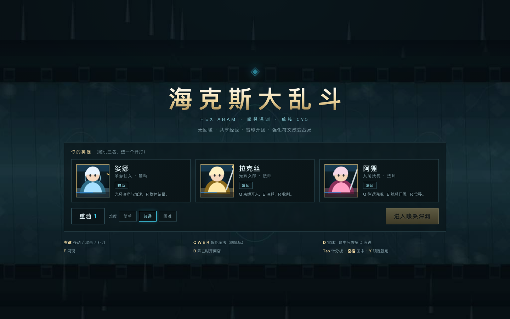
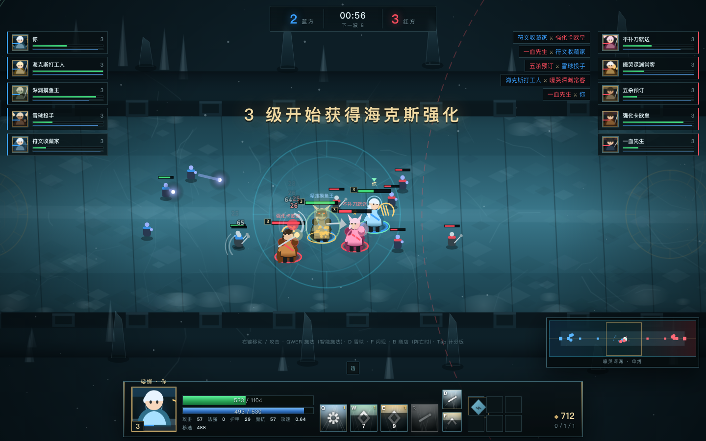

# 海克斯大乱斗 · HEX ARAM

单线 5v5 的网页版「海克斯大乱斗」：嚎哭深渊、无回城、共享经验、雪球开团，3/6/9/12/15 级各来一次**海克斯强化三选一**。

- 纯静态：`index.html` + 原生 ES Module + Canvas 2D，**零依赖、零外部素材**
- 所有角色、建筑、地形、图标、音效都是代码程序化生成
- 单机可玩：玩家 + 4 名 AI 队友 vs 5 名 AI 对手，三档难度
- 部署：GitHub Pages（`hex-aram/` 目录直接发布）




## 玩法

| 系统 | 说明 |
|---|---|
| 地图 | 3D 嚎哭深渊冰桥：抬升桥面、岩壁、雪原、冰晶、火盆；双方各 2 塔 + 水晶 + 主水晶 |
| 经济 | 被动金币 + 补刀 + 击杀/助攻 + 推塔，阵亡时才能购物 |
| 经验 | 附近共享 + 全局节奏经验，18 级封顶，技能自动升级（R 在 6/11/16 级） |
| 强化 | 3 / 6 / 9 / 12 / 15 级各一次三选一，银 → 金 → 棱彩，可重随一次 |
| 召唤师技能 | **D 雪球**（命中后再按 D 突进）、**F 闪现** |
| 兵线 | 每 25 秒一波，每 3 波带炮车；水晶被拆后出超级兵 |
| 野区 | 桥中两侧定时刷新治疗圣物（回 20% 生命/法力），3D 悬浮水晶 |
| 草丛 | 10 处草丛：草内单位对外隐身，同草敌人可见，施法/攻击显形 1.5 秒 |

## 操作

| 按键 | 功能 |
|---|---|
| 右键 | 移动 / 攻击 / 补刀 |
| Q W E R | 智能施法（朝鼠标方向） |
| D / F | 雪球 / 闪现 |
| A + 右键 | 攻击移动 |
| S | 停止 |
| B | 商店（阵亡时） |
| Tab | 计分板（按住） |
| 空格 | 镜头回中 |
| Y | 锁定 / 解锁视角（解锁后中键拖动、边缘滚屏） |
| 滚轮 | 缩放 |
| Esc | 暂停 / 关闭弹窗 |

## 英雄

艾希 · 吉格斯 · 拉克丝 · 贾克斯 · 阿利斯塔 · 亚索 · 阿狸 · 赛恩 · 娑娜 · 孙悟空

每人 4 个技能，覆盖直线弹道、锥形、地面 AOE、突进、护盾/治疗、风墙、击飞、魅惑、处决等机制。

## 本地运行

```bash
python3 -m http.server 8899
# 打开 http://127.0.0.1:8899/
```

任意静态服务器都可以；ES Module 需要通过 HTTP 访问，不能用 `file://` 直接打开。

## 3D 渲染

- `js/render3d.js`：Three.js 场景 / 透视镜头 / 3D 角色与建筑 / 地面投影血条与飘字
- `vendor/three.module.js`：本地内置 Three.js 0.160.1
- 相机：透视 42°，跟随英雄，滚轮缩放，Y 解锁自由视角

## 结构

```
hex-aram/
├── index.html
├── css/style.css
└── js/
    ├── main.js     入口：循环、输入、镜头、开局装配
    ├── data.js     英雄/技能/装备/强化/小兵/建筑数值
    ├── sim.js      战斗模拟：单位、技能判定、伤害、经济、兵线
    ├── ai.js       Bot：补刀、消耗、撤退、买装备
    ├── map.js      地图几何与背景绘制
    ├── render.js   角色/建筑/特效/小地图渲染
    ├── ui.js       HUD、商店、强化卡、计分板
    └── audio.js    WebAudio 程序化音效
```

## 部署

`.github/workflows/pages-hex-aram.yml` 会把 `hex-aram/` 作为 Pages 站点发布：

`https://yufeng66688.github.io/raa-arena/`

---

本项目是玩法层面的同人复刻练习：代码、美术、音效全部为原创程序化实现，不包含任何官方素材。
